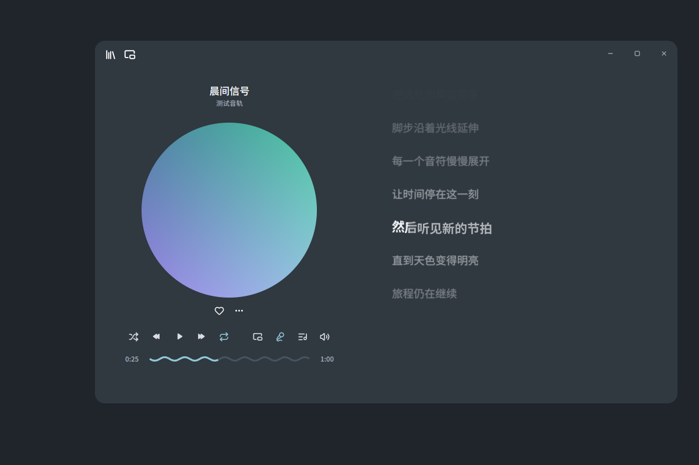
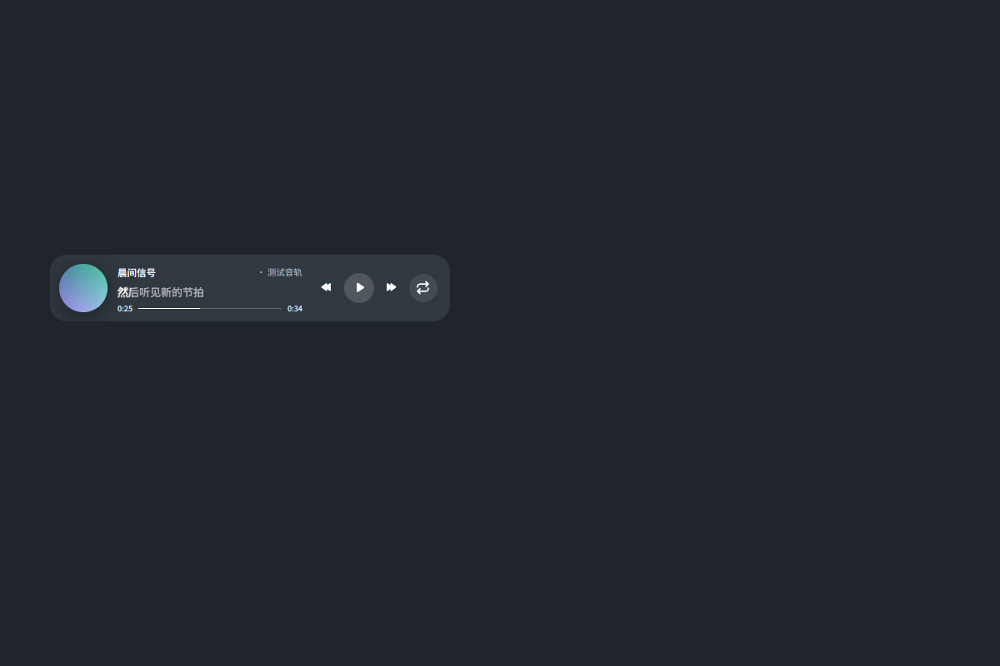

# AMS — GPUI Music Player

Rust + native GPUI music player targeting **Windows 10 x64**, adapted from
[cradiy/gpui-apple-music-demo](https://github.com/cradiy/gpui-apple-music-demo)
with its pinned [GPUI Fusion](https://github.com/cradiy/gpui-fusion) backend.
No Electron, Tauri, WebView, or web frontend.




Screenshots use independent test artwork/lyrics. See verification status below
before treating them as Windows screenshots.

## Features

- Slate/Fluent palette: `#20252B`, `#303840`, ice-blue `#91C8D5`, readable light text.
- Circular cover, original left controls/right lyrics layout, native GPUI wave progress.
- Local library, metadata/artwork, playlists, favorites, queue, shuffle/repeat and volume.
- Existing Symphonia + CPAL playback and line/word timed lyrics with smooth scrolling.
- Frameless native caption buttons: minimize, maximize/restore, close; transparent
  at rest with subtle hover backgrounds. Native resizing, drag, Snap and caption
  double-click remain delegated to GPUI/Win32.
- Bundled Noto Sans SC variable font (SIL OFL 1.1). Title Medium, artist Regular,
  current lyric Semibold, surrounding lyrics Regular; no font installation.
- Win10 Acrylic is optional and dynamically detected. Older builds, RDP,
  disabled transparency or unavailable APIs fall back to an opaque slate panel.
  Set `[appearance] backdrop = "opaque"` to force the fallback.
- Queue artwork uses 96px thumbnails, a viewport working set capped at 64 covers,
  two background workers and decode allocation limits; full-size covers are not
  uploaded for small queue cells. Main cover file preparation also runs off the UI.
- Mini player shares the original playback entity and restores the main window.
- Portable ZIP keeps configuration, state, logs and artwork cache beside the EXE.

YouTube Music remains a planned source. The `MusicProvider` interface and local
adapter exist, but Google login, live YouTube metadata and remote playlist calls
are **not implemented**. There is no compliant general official native YouTube
Music audio API for this UI. No stream extraction, cookies or DRM bypass is used.
See [provider boundaries](docs/PROVIDERS.md).

## Download and launch

Use a **preview** from [Releases](https://github.com/shannoncheu/ams/releases), or the
`gpui-music-windows-x64` artifact from a successful [Windows x64 Release](https://github.com/shannoncheu/ams/actions/workflows/windows.yml) Actions run.

| Asset | Usage |
| --- | --- |
| `GPUI-Music-Player.exe` | Embedded fonts/icons/shaders; normal per-user storage. Check the dependency report if DLLs accompany a release. |
| `GPUI-Music-Player-Windows-x64.zip` | EXE, any required runtime DLLs, instructions and third-party notices. |
| `GPUI-Music-Player-Portable-x64.zip` | Complete bundle with `portable.flag`; extract into a writable folder and run without administrator rights. |
| `SHA256SUMS.txt` | Verify downloads with `Get-FileHash -Algorithm SHA256`. |

Do not run inside the ZIP or extract into Program Files for portable use.
The EXE and ZIP are unsigned previews; signing is not currently configured.
Use the library icon at the upper left (or the empty cover) to import music.
Hover the volume icon for its slider. Click the mini cover to restore the main player.

## Windows build

Install Rust stable **MSVC x64**, Visual Studio 2022 Build Tools with Desktop C++
x64/x86 tools, and Windows 10 SDK including `fxc.exe`. In Developer PowerShell:

```powershell
cargo check --locked
cargo test --locked
cargo build --release --locked
```

If FXC is not found, set `GPUI_FXC_PATH` to the installed SDK's x64 `fxc.exe`.
The Windows workflow uses `windows-2022`, static CRT linkage, checks/tests,
Release compilation, dependency inspection, license collection and packaging.
It extracts the Portable ZIP into a new folder, starts it from an unrelated
working directory and verifies normal exit, native window creation and local config.
Artifacts are uploaded automatically; `v*` tag builds attach them to preview Releases.

For a local package, run `python scripts/collect-licenses.py` then
`./scripts/package-windows.ps1` after Release compilation. Package scripts require
Developer PowerShell (`dumpbin.exe`). See [Windows instructions](docs/WINDOWS.md)
and [portable paths](docs/PORTABLE.md).

## Verification and known limitations

- Linux compilation and automated tests have run; native rendering and mini/main
  switching were exercised under headless Wayland with software Vulkan.
- GitHub Actions Windows results are reported by the actual workflow run. A
  workflow file by itself is not a successful Windows build.
- `windows-2022` runs **Windows Server 2022**, not Windows 10. Successful CI startup
  does not validate real Win10 Acrylic, fonts, Snap, taskbar bounds, audio devices,
  DPI/multi-monitor behavior, or hardware GPU performance.
- **Windows 10 physical-machine acceptance has not been completed.** No 100 MB
  memory claim, 60 FPS guarantee, or CPU/GPU target pass is made.
- Linux Pulse/ALSA virtual-output retests showed intermittent I/O errors despite
  successful nonzero PCM captures. Audio stability remains under investigation.
- Background image modes, full cover crossfade, mini expand/collapse animation,
  user-toggleable always-on-top and indexed large-library loading remain pending.

See [current results](docs/PROGRESS.zh-CN.md) and Actions build reports. CI peak
working set is startup telemetry on Server 2022, not a Win10 performance benchmark.

## Licenses and credits

This project retains the upstream [MIT license](LICENSE), copyright and history.
GPUI Fusion includes MIT and Apache-2.0 packages with Zed-derived attribution;
Lucide icons retain ISC/Feather notices. The bundled font's [OFL](assets/fonts/OFL.txt)
and [source/hash](assets/fonts/SOURCE.md) ship with each package. CI collects locked
dependency notices in `THIRD_PARTY_NOTICES.txt` and a license inventory. Unchanged
MPL-covered dependency source (including Symphonia) is bundled in
`licenses/THIRD_PARTY_SOURCES.zip`; missing notice files are resolved from the
published VCS commit or [version-specific source clarifications](licenses/CLARIFICATIONS.md); unresolved notices stop packaging.

PixelPlayer is only a visual inspiration for the independently written sine-wave
track. No PixelPlayer source or assets are redistributed. Original upstream
documentation is preserved in [UPSTREAM_README.md](docs/UPSTREAM_README.md).

Windows 10 baseline: 1903 or newer (22H2 recommended), x64. The executable imports the system ICU library; earlier Windows 10 builds are not supported by this preview. Physical-machine validation remains pending.
